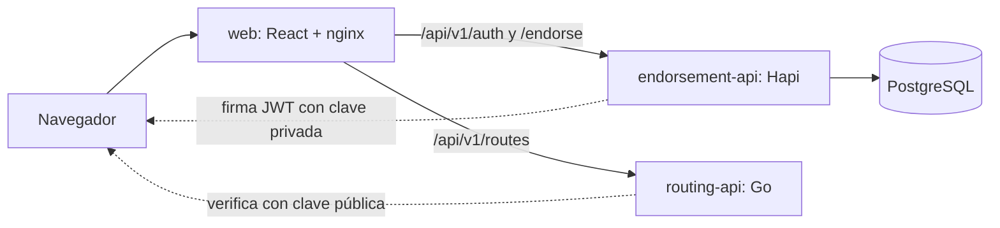

# Reto técnico Interseguro: Technical Lead

Monorepo con los tres ejercicios del reto.

| Reto | Solución | Dónde |
| --- | --- | --- |
| 1. Traductor de endosos | API en Node, Hapi y TypeORM con plantillas en PostgreSQL | [services/endorsement-api](services/endorsement-api) |
| 2. Rutas óptimas | API en Go con Dijkstra multiorigen | [services/routing-api](services/routing-api) |
| Frontend de ambos | React y Vite, servido con nginx | [apps/web](apps/web) |
| 3. Préstamos | Arquitectura AS-IS y TO-BE en draw.io | [architecture](architecture/prestamos-to-be.md) |



## Ejecutar

Requiere Docker y `openssl`.

```bash
./scripts/dev-setup.sh
```

```bash
docker compose up -d --build
```

Abre http://127.0.0.1:8088. El usuario es `demo`, y `dev-setup.sh` imprime una contraseña aleatoria que queda en `.env`.

| Servicio | Dirección |
| --- | --- |
| Frontend | http://127.0.0.1:8088 |
| Documentación del traductor (Swagger) | http://127.0.0.1:3011/documentation |
| Contrato de rutas (OpenAPI) | [docs/openapi/routing-api.yaml](docs/openapi/routing-api.yaml) |

Prueba de punta a punta sobre el sistema levantado:

```bash
./scripts/smoke-test.sh
```

Agregar un producto nuevo solo con SQL:

```bash
./scripts/demo-add-product.sh
```

## API

Todas las rutas requieren `Authorization: Bearer <token>`, salvo el login.

| Método | Ruta | Descripción |
| --- | --- | --- |
| POST | `/api/v1/auth/login` | Obtiene un JWT de 15 minutos |
| POST | `/api/v1/endorse/translate` | Traduce el JSON plano al JSON del core |
| GET | `/api/v1/endorse/templates` | Lista las plantillas activas y sus campos |
| POST | `/api/v1/routes/optimal` | Calcula la ruta óptima |

| Código | Significado |
| --- | --- |
| 400 | Entrada inválida |
| 401 | Token ausente o inválido |
| 404 | No hay plantilla activa |
| 413 | Cuerpo demasiado grande |
| 422 | Faltan campos, un valor no cumple el tipo de la plantilla (por ejemplo, una fecha) o el siniestro es inalcanzable |

El traductor devuelve en el cuerpo exactamente el JSON del core, y la plantilla usada en las cabeceras `x-template-id` y `x-template-version`.

## Lima simulada

La pantalla de rutas incluye una red de 16 distritos con **datos sintéticos**, en un formato parecido a Google Routes. No consulta a Google ni usa mediciones reales.

La respuesta simulada pasa por un adaptador que la convierte en el grafo de siempre, y Dijkstra se ejecuta sin cambios. Con el escenario inicial, por distancia gana Surco y por tiempo gana San Isidro.

Para regenerar los datos:

```bash
node scripts/generate-synthetic-routes.mjs
```

## Estructura

```text
apps/web/                  Frontend compartido
services/endorsement-api/
  src/routes/              Rutas, autenticación y validación
  src/controllers/         Entrada y salida HTTP
  src/services/            Lógica de negocio
  src/entities/            DTO y entidades de negocio
  src/repositories/        Acceso a datos
  src/models/              Modelos de TypeORM
  src/mappers/             Motor de traducción
  database/                Seeds y ejemplos SQL
  tests/                   Pruebas unitarias y de integración
services/routing-api/
  internal/graph/          Algoritmo, sin dependencias de HTTP
  internal/httpapi/        API HTTP
  internal/auth/           Verificación de JWT
architecture/              Diagramas, diseño de préstamos y ADR
docs/                      Modelo de datos, despliegue y guía de entrevista
scripts/                   Preparación, pruebas y despliegue
```

## Pruebas

```bash
cd services/endorsement-api && npm ci && npm test && npm run test:integration
```

```bash
cd apps/web && npm ci && npm test
```

```bash
docker run --rm -v "$PWD/services/routing-api":/src -w /src golang:1.27-alpine go test ./...
```

Las pruebas de integración levantan PostgreSQL con Testcontainers. Verifican la salida exacta del PDF, incluido el orden de las claves, y que un producto nuevo funcione solo con SQL.

## Documentación

- [Diseño de préstamos](architecture/prestamos-to-be.md)
- [Decisiones de arquitectura](architecture/decisions)
- [Cómo funciona Dijkstra](docs/dijkstra-explicado.md)
- [Modelo de datos](docs/modelo-datos.md)
- [Despliegue en GCP](docs/despliegue-gcp.md)
- [Guía para la entrevista](docs/guia-entrevista.md)

## Limitaciones conocidas

- Hay un solo usuario demo, sin renovación de tokens ni límite de intentos de login.
- Las plantillas se administran por SQL; no hay pantalla ni validación de publicación.
- La red de Lima es sintética: no representa calles, distancias ni tráfico reales.
- El reto 3 es un diseño: no incluye código de préstamos.
