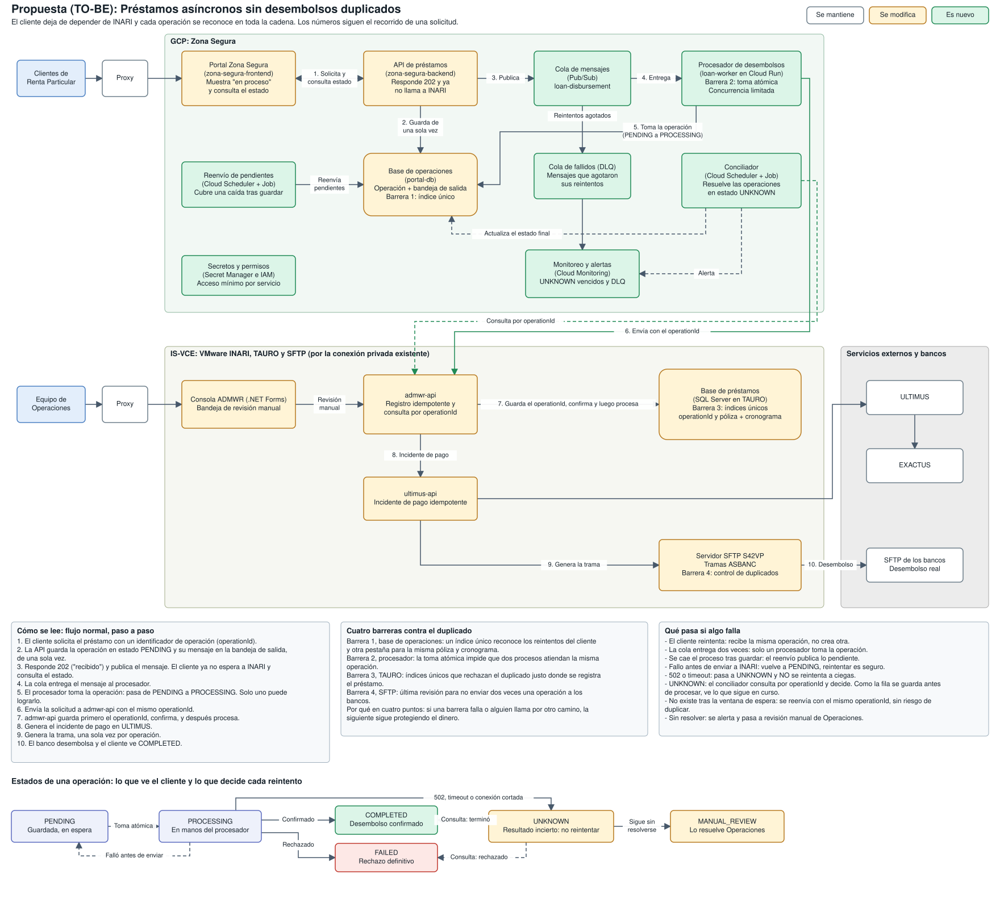
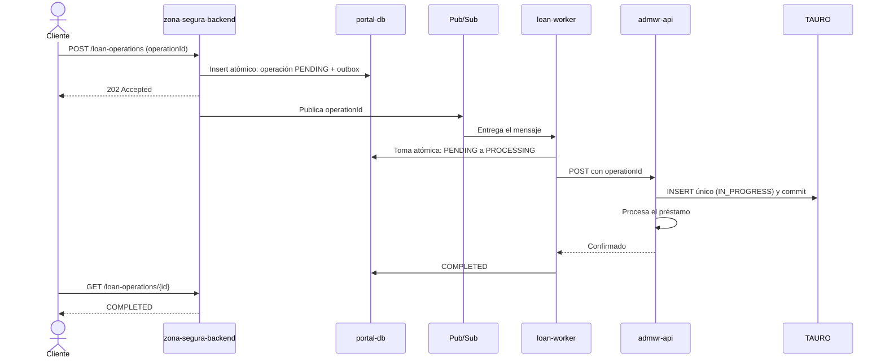
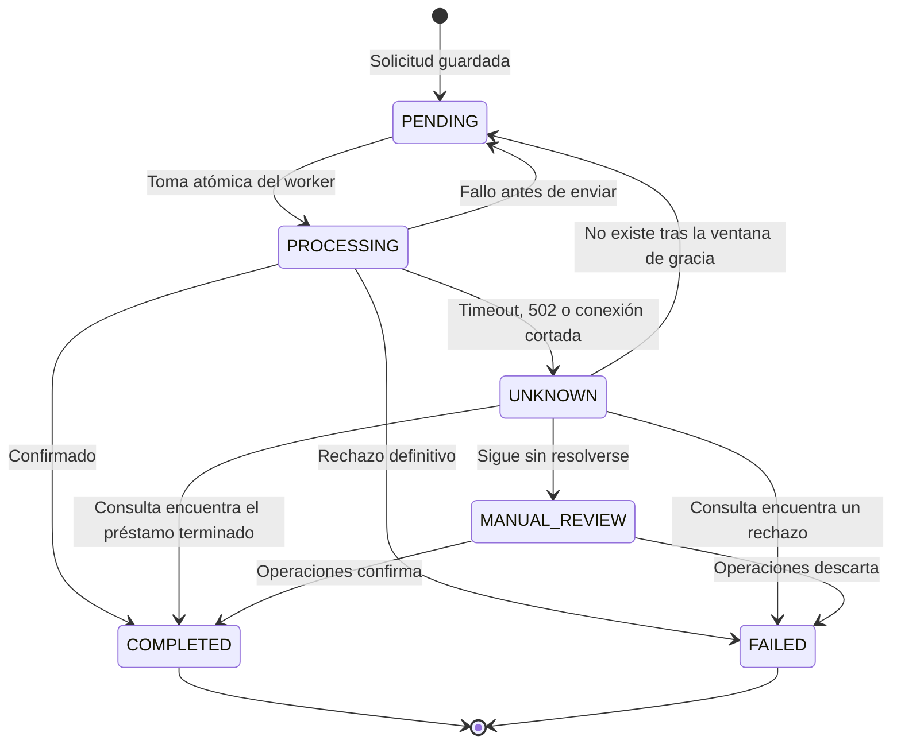

# Préstamos de Renta Particular: arquitectura TO-BE

Diagramas editables: [as-is.drawio](as-is.drawio) y [to-be.drawio](to-be.drawio). Cada archivo abre en una vista simple y trae una página "Detalle" con todos los componentes.

Vista completa: [situación actual](as-is-detalle.svg) y [propuesta](to-be-detalle.svg).

## El problema

La causa no es el 502: es que el sistema no puede reconocer dos intentos de la misma operación. Mientras el cliente espere a INARI y cada reintento cree un préstamo nuevo, cualquier lentitud puede convertirse en un desembolso duplicado.

## La solución en cuatro decisiones

1. **Separar la espera del cliente del procesamiento.** El backend guarda la solicitud, responde `202` y el cliente consulta el estado. INARI ya no interviene en esa respuesta.
2. **Dar identidad a cada operación.** El backend crea un `operationId` cuando el cliente inicia la solicitud. Todos los reintentos usan ese identificador.
3. **Bloquear duplicados donde se registra el dinero.** Los índices únicos de TAURO son el control definitivo, porque también cubren reintentos, mensajes repetidos y llamadas de otros orígenes.
4. **Nunca reintentar a ciegas.** Si no se sabe qué pasó, la operación pasa a `UNKNOWN` y se consulta antes de actuar.

## Flujo normal

## Estados

## La pregunta clave

> Si INARI confirma tarde, se corta la comunicación y el cliente vuelve a intentarlo, ¿cómo se evita el doble desembolso?

| Momento | Qué ocurre | Por qué no se duplica |
| --- | --- | --- |
| El cliente reintenta | Llega el mismo `operationId` | El índice único de `portal-db` devuelve la operación existente |
| El cliente abre otra pestaña | Llega otro `operationId` para la misma póliza y cronograma | El índice de negocio rechaza una segunda solicitud activa |
| Pub/Sub entrega dos veces | Dos workers reciben el mensaje | Solo uno logra pasar de `PENDING` a `PROCESSING` |
| INARI responde 502 | El worker no sabe el resultado | La operación pasa a `UNKNOWN`; no se reintenta |
| `admwr-api` sigue trabajando | El reconciliador consulta por `operationId` | La fila se confirmó antes de procesar, así que aparece como `IN_PROGRESS` y se espera |
| Se reenvía de todos modos | Llega el mismo `operationId` a `admwr-api` | La restricción única de TAURO rechaza el segundo registro y se devuelve el resultado original |

Lo decisivo es el orden dentro de `admwr-api`: **primero confirma la fila con el `operationId` y después procesa**. Así, una consulta nunca puede responder "no existe" sobre algo que ya está en curso.

## Criterios del reto

| Criterio | Cómo se atiende |
| --- | --- |
| **Escalabilidad** | El backend y el worker escalan por separado. La cola absorbe los picos sin trasladarlos a INARI. |
| **Resiliencia y reintentos** | Pub/Sub reintenta con espera creciente y DLQ. El outbox evita perder mensajes. Solo se reintenta lo que es seguro. |
| **Control de concurrencia** | Índices únicos, toma atómica de estado y `max-instances` bajo en el worker para no saturar INARI. |
| **Seguridad** | Sesión de la Zona Segura en cada solicitud, comprobando que la póliza sea del cliente. IAM y Secret Manager por servicio. Autenticación entre servicios. Sin datos financieros en logs ni mensajes: la cola solo lleva `operationId`. |
| **Costo** | Reutiliza `portal-db`, Cloud Run y la conectividad actual. Los servicios nuevos cobran por uso. No se agregan Kafka, Kubernetes ni otra base de datos. |

## Decisiones importantes

- **Reutilizar `portal-db`.** Evita otra base. El ícono del diagrama sugiere MongoDB. En ese caso, la operación y su outbox se guardan en un solo documento, cuya escritura ya es atómica.
- **Sondeo en vez de WebSockets.** Es más simple y suficiente para una operación que tarda segundos o minutos.
- **Publicar y además barrer el outbox.** El backend publica de inmediato para reducir la espera. El barrido periódico cubre el caso en que el proceso cae justo después de guardar.
- **Control adicional antes del SFTP.** Es la última barrera antes de que el dinero salga hacia los bancos: las tramas no incluyen un `operationId` ya enviado.

## Implementación por etapas

Reduce el riesgo pronto, sin esperar a tener todo el flujo asíncrono.

| Etapa | Cambio | Resultado |
| --- | --- | --- |
| **0. Contención** | Índices únicos en TAURO, control en tramas SFTP y botón bloqueado tras el envío | Corta la mayor parte del daño |
| **1. Idempotencia** | `admwr-api` e `ultimus-api` aceptan `operationId` y permiten consultarlo | Los reintentos pasan a ser seguros |
| **2. Flujo asíncrono** | `202`, outbox, Pub/Sub, worker y pantalla de estado | El cliente deja de depender de INARI |
| **3. Conciliación** | Reconciliador, bandeja de revisión, métricas y alertas | Los casos dudosos se resuelven con trazabilidad |

Antes de empezar hay que revisar los desembolsos históricos para definir la regla de negocio del duplicado y detectar registros que impidan crear los índices.

## Métricas

- Operaciones por estado y tiempo hasta `COMPLETED`.
- Cantidad y antigüedad de `UNKNOWN` y `MANUAL_REVIEW`.
- Mensajes en la DLQ y antigüedad del outbox.
- Duplicados bloqueados por cada índice: si suben, algo está reintentando de más.
- Latencia y errores de INARI.

## Supuestos y límites

- **`admwr-api` y `ultimus-api` se pueden modificar.** Si no fuera posible, ya no se podría garantizar la unicidad en el punto donde se registra el dinero. Quedaría una protección parcial: consultar TAURO antes de enviar, procesar en serie por póliza y conciliar. El riesgo de duplicidad se reduce, pero no desaparece.
- **Los bancos y ULTIMUS no están bajo nuestro control.** La garantía cubre hasta generar cada trama e incidente una sola vez. Lo que ocurra después se detecta con conciliación contra sus reportes.
- **La regla del duplicado la define el negocio.** Aquí se asume póliza + cronograma. Debe confirmarse, sobre todo si un cliente puede pedir legítimamente dos préstamos parecidos.
- **El estado actual se dedujo del diagrama y el texto del reto.** Hay que validar la conectividad, la versión de `portal-db` y los tiempos reales de INARI.
- **El costo no se presenta en cifras** porque depende del volumen real, que el reto no indica. Se estimaría con la calculadora de GCP.
