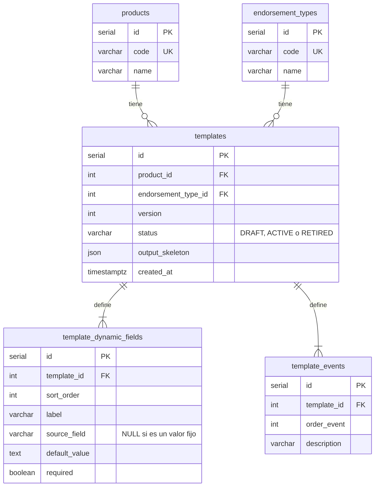

# Modelo de datos del traductor

## Reglas que protege la base de datos

| Regla | Mecanismo |
| --- | --- |
| Una versión activa por producto y tipo | Índice único parcial `templates_one_active_per_key` |
| Sin versiones repetidas | `UNIQUE (product_id, endorsement_type_id, version)` |
| Sin órdenes ni etiquetas repetidas | `UNIQUE (template_id, sort_order)` y `UNIQUE (template_id, label)` |
| Todo campo puede producir un valor | `CHECK` `field_has_value_source` |

## Directivas del esqueleto

`output_skeleton` describe la forma del JSON. Lo que no es una directiva se copia tal cual.

| Directiva | Resultado |
| --- | --- |
| `{"$input": "moneda"}` | Valor del campo de entrada; es obligatorio |
| `{"$input": "moneda", "$default": "Nuevo Sol"}` | Igual, con un valor por defecto si el campo está ausente |
| `{"$dynamicData": true}` | Lista ordenada de `{ etiqueta, value }` |
| `{"$eventAppliedEntities": true}` | Lista ordenada de `{ description, orderEvent }` |
| `{"$primaryEvent": true}` | Descripción del primer evento |

## Valores ausentes y vacíos

| Entrada | Con default | Sin default y obligatorio | Sin default y opcional |
| --- | --- | --- | --- |
| Campo ausente | Usa el default | 422 | `null` |
| `null` | `null` (422 si es obligatorio) | 422 | `null` |
| `""` | `""` | `""` | `""` |

## Agregar un producto

No requiere cambios de código. Basta un script como [add_product_vida_cambio_moneda.sql](../services/endorsement-api/database/examples/add_product_vida_cambio_moneda.sql).

Para publicar una versión nueva, en una misma transacción se marca la anterior como `RETIRED` y se inserta la nueva como `ACTIVE`.
